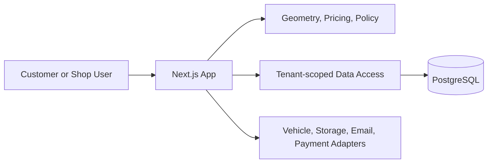

# Exhaustaholics
Automated exhaust to undercarriage fitment software.

Exhaustaholics is a design-intent and shop workflow platform for custom exhaust projects. Geometry and fitment are approximate until verified on the vehicle; the application must not present sound or performance goals as measured predictions.

## Local Development

Requirements: Node.js 24 and npm.

```bash
npm ci
npm run dev
```

Open http://localhost:3000. No external credentials are required for the initial application shell.

## Checks

```bash
npm run lint
npm run typecheck
npm test
npm run build
```

## Architecture

The app uses Next.js App Router and TypeScript. Planned domain boundaries include framework-free geometry and pricing modules, tenant-scoped data access, a central permissions policy, and provider adapters for external services. The initial scaffold does not yet include persistence, authentication, or those domain modules.



## Product Limitations

Vehicle envelopes and clearance checks are approximate. Designs are design intent, not shop-floor truth. Always verify measurements and fit before fabrication. No bundled vehicle CAD or manufacturer models are included.
