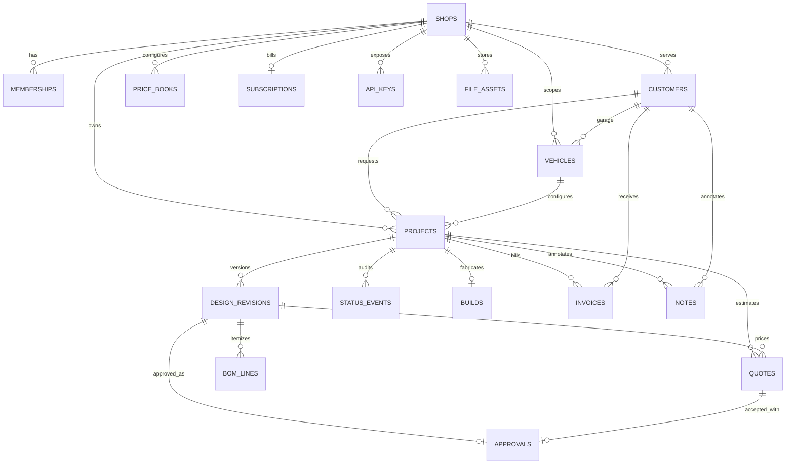

# Data Schema

PostgreSQL is the source of truth when `DATABASE_URL` is configured. `lib/db/schema.ts` defines the tables and indexes; generated migrations are stored in `lib/db/migrations/`. The demo shell remains available without a database.

## Entity Relationships

## Tables

| Table | Purpose and tenant fields |
|---|---|
| `shops` | Shop identity, slug, contact, and branding. Primary tenant key is `id`. |
| `memberships` | Shop user IDs and role; composite primary key `(shop_id, user_id)`. |
| `customers` | Shop CRM contact; `shop_id` is required and `owner_id` can link a customer login. |
| `vehicles` | Garage data, modifications, and envelope provenance. `shop_id` may be null for individual owners; `owner_id` is required. |
| `projects` | Customer goals and workflow status. Carries `shop_id` or `owner_id`, plus vehicle/customer and optional fabricator assignment. |
| `design_revisions` | Immutable numbered design snapshots with nodes, segments, components, dimensions, material, mirror flag, and content hash. |
| `quotes` | Integer-cent total, line items, rate snapshot, status, creator, and idempotency key. |
| `bom_lines` | Revision-linked quantities, units, cents, and formula inputs. |
| `approvals` | Accepted revision and quote snapshot, timeline acceptance, signature metadata, document hash, time, and IP. |
| `status_events` | Append-only project status audit history. |
| `builds` | Shop build assignment and schedule. |
| `invoices` | Integer-cent customer invoices tied to project and optional quote. |
| `notes` | Shop-only customer/project notes. |
| `price_books` | Shop-specific configurable rates; `is_sample` marks illustrative books. |
| `subscriptions` | Tier, status, Stripe identifiers, and current period. |
| `api_keys` | Hashed API key only, with scopes and expiry; raw keys are never stored. |
| `file_assets` | Private storage key, owner/shop scope, content metadata, and expiry. File access is through short-lived signed URLs only. |

## Important Indexes

- `shops`: unique slug.
- `memberships`: composite `(shop_id, user_id)` primary key and user lookup.
- `customers`: shop, shop/email, and owner lookups.
- `vehicles`: shop, owner, customer, and `(make, model, year)` catalog lookups.
- `projects`: `(shop_id, status)`, `(owner_id, status)`, customer, vehicle, and `(assigned_fabricator_id, status)`.
- `design_revisions`: unique `(project_id, revision_number)`, shop, and owner.
- `quotes`: unique idempotency key, `(shop_id, status, created_at)`, owner, and project.
- `bom_lines`: revision, shop, and owner.
- `approvals`: unique revision, project, shop, and owner.
- `status_events`: `(project_id, created_at)`, `(shop_id, created_at)`, and owner.
- `builds`: unique project, `(shop_id, due_at)`, and assignee.
- `invoices`: `(shop_id, status)`, customer, and owner.
- `notes`: `(shop_id, created_at)`, customer, and project.
- `price_books`: unique `(shop_id, name)` and shop.
- `subscriptions`: unique shop and Stripe subscription ID.
- `api_keys`: unique key hash and shop.
- `file_assets`: unique storage key, shop, and owner.

## Tenant Isolation

`lib/db/access.ts` is the server-only data-access layer. Each query validates a `TenantScope`, opens a transaction, sets transaction-local `app.shop_id` and `app.owner_id`, and applies explicit matching predicates. If both IDs are supplied, query predicates require both. PostgreSQL RLS is enabled and forced for every table; its policies allow rows matching either current context. Never query tenant tables outside the DAL or trust a client-supplied shop ID without validating the authenticated membership first.

## Immutability

PostgreSQL rejects `UPDATE` and `DELETE` on approved design revisions, approvals, and status events. An approval stores the revision ID, accepted quote total, timeline acceptance, signature metadata, and document hash as an audit snapshot. A change to a design creates another revision and requires another approval.

## Value Conventions

- Money is integer cents.
- Geometry is real-valued inches.
- Envelope class dimensions are sample approximations, not per-vehicle measurements.
- Missing rates remain `null`; zero is only used when explicitly configured.